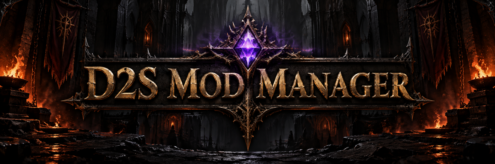
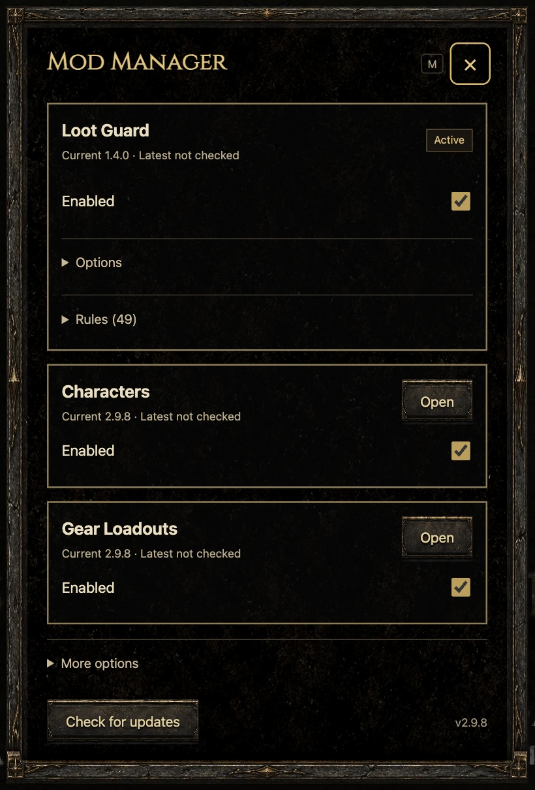
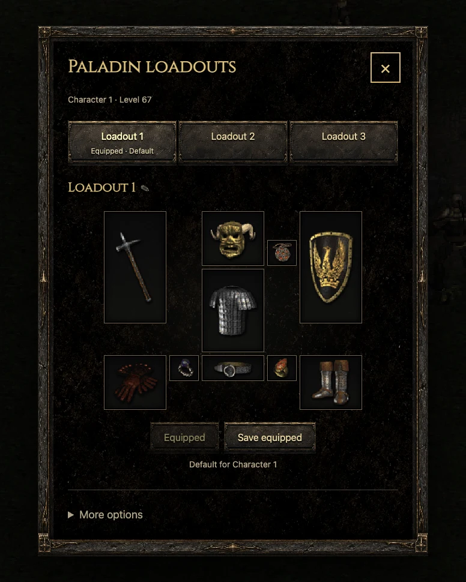
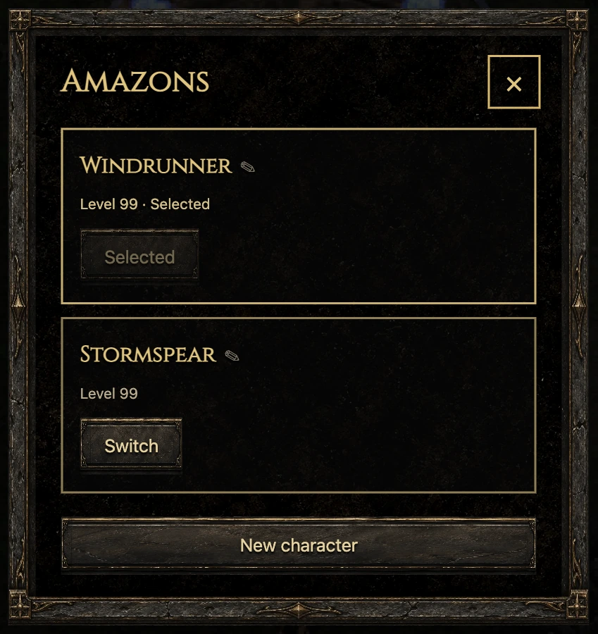

<p align="center">
  
</p>

<p align="center">
  Community enhancements for <a href="https://d2survivors.lol/play/">D2 Survivors</a>.
</p>

<p align="center">
  <a href="https://d2s.arken.gg/"><strong>Install Mod Manager</strong></a> ·
  <a href="docs/README.md">Documentation</a> ·
  <a href="CONTRIBUTING.md">Create a mod</a> ·
  <a href="CHANGELOG.md">What's new</a>
</p>

---

## Enter the game

1. Visit **[d2s.arken.gg](https://d2s.arken.gg/)** and drag the large button to your bookmarks bar.
2. Open **[D2 Survivors](https://d2survivors.lol/play/)** and click your **D2SMM** bookmark.
3. Press **M** to open the manager. Enable the mods you want.

Click the bookmark again after reloading the game. No account or game-file replacement is needed.

## The arsenal

| Mod | What it does | Source |
| :--- | :--- | :--- |
| **Loot Guard** | Marks exceptional magic and rare drops with `***`, protects matches from hiding / auto-sell, and offers sound alerts. Editable JSON rules for every class. | [Loot Guard](mods/loot-guard/) |
| **Characters** | Keeps up to three heroes of the same class using the game's archived-character system. Create a new hero after level 99; choose heroes at the campfire. | [Characters](mods/characters/) |
| **Gear Loadouts** | Three outfits per class, real item previews, and hover stats. Reuse the same item across outfits and assign a default to each hero. | [Gear Loadouts](mods/gear-loadouts/) |
| **Terrorized** | Replay the Terror tier and act you just finished, or gather run drops into a ring after the boss falls. | [Terrorized](mods/terrorized/) |
| **QoL** | Put newly picked-up charms into Charms when they fit, with a red unread dot until you open it. | [QoL](mods/qol/) |

**The gem keeps watch.** Purple means at least one mod is enabled; blue means all mods are off. A bright white gem calls out important events. Uncollected matched loot stays in its hover log until resolved; other notices expire after a minute. During play, the gem sits over the bottom-center mini-panel button. Click it to open the manager.

<p align="center">
  
  
  
</p>

<p align="center"><sub>Interface previews; labels may differ slightly from the latest release.</sub></p>

## Enhancements. No botting or automated play.

We include mods that respect the integrity of D2 Survivors. Better information, cleaner interfaces, and deliberate player actions belong here. Automated combat, farming, and progression bypasses do not.

Creating extra heroes and reserving stash space are **opt-in**. These mods manage real heroes and items; they do not clone equipment or swap whole saves. Export a game backup before trying save-affecting features. [Read the storage boundaries →](mods/gear-loadouts/README.md)

Each mod has its own on/off control. Disabling Characters or Gear Loadouts keeps saved heroes, loadouts, and reserved gear intact. Turn the mod back on to manage them; use the explicit release action to free a reserved stash.

This is an independent community project, not an official D2 Survivors or Blizzard product.

## Forge something useful

Start with a small improvement: a carefully tested loot rule, a clearer interface, a compatibility fix, or a new mod proposal.

- **Edit rules:** export JSON from Loot Guard, change it, and import it back. [Rule guide →](docs/loot-rules.md)
- **Submit a mod:** describe the player benefit and game hooks, then open a focused pull request. [Contribution guide →](CONTRIBUTING.md)
- **Use Claude or ChatGPT:** give it the docs and a narrow goal. Ask it to explain the change, preserve game integrity, and help you test it. Review the result before submitting.

Dropped packages currently support **declarative loot rules**. Executable mods are reviewed source integrations; arbitrary JavaScript files are not accepted by the installer.

## Build from source

The browser runs plain JavaScript. A small native C++ tool assembles the release—no npm, Node, or Python build step.

```sh
cmake -S . -B build -DOPENSSL_ROOT_DIR="$(brew --prefix openssl@3)"
cmake --build build --target d2smm-build
ctest --test-dir build -R build-tool --output-on-failure
./build/d2smm-build --source . --output dist
```

This example is for macOS with CMake, a C++20 compiler, and OpenSSL 3 installed. Linux instructions and browser verification are in the [development guide](docs/development.md).

## Explore the repository

This repository is the source of truth for the manager, built-in mods, and installer website. Edit source here; generated distributions and historical captures are outputs.

| Directory | Purpose |
| :--- | :--- |
| [`src/manager/`](src/manager/) | Installation, updates, storage, manager UI, and shared attention log |
| [`src/game/`](src/game/) | Verified game hooks, native menu, and canvas focus |
| [`mods/`](mods/) | Mod source, packages, and feature guides |
| [`site/`](site/) | The installer website |
| [`extension/`](extension/) | Optional unpacked Chrome startup loader |
| [`assets/`](assets/) | UI textures, gems, and licensed font |
| [`tools/`](tools/) · [`tests/browser/`](tests/browser/) | Native build / CDP tools and focused browser checks |
| [`docs/`](docs/) | Getting started, rules, API, architecture, and releases |

## Documentation

[Getting started](docs/getting-started.md) · [Loot rules](docs/loot-rules.md) · [Mod API](docs/api.md) · [Architecture](docs/architecture.md) · [Development](docs/development.md) · [Releases](docs/releases.md)

First-party code is [MIT licensed](LICENSE). Fonts, dependencies, screenshots, and artwork have their own [attribution and rights notes](NOTICE.md).
